<!-- ========================== ANIMATED HERO ========================== -->

  

  

  

    
    
    
  

---

## 👨‍💻 About Me

I'm **Md Mazidul Islam**, a backend engineer interested in building reliable software systems and practical AI-powered applications. I have **1.5+ years of backend development experience** and a growing focus on ML engineering, LLM applications, and intelligent automation.

- ⚙️ I build backend services, APIs, database-backed applications, and asynchronous workflows.
- 🧠 I explore RAG, LLM evaluation, AI agents, model serving, and ML system design.
- 🛡️ I value measurable results, testing, data quality, security, and clear engineering trade-offs.
- 🎓 B.Tech in Computer Science and Engineering — Lovely Professional University (2020–2024).

> My engineering approach: make it work, measure it, test its limits, and make it reliable.

## ⚡ What I Build

  <table>
    <tr>
      <td align="center" width="25%">
        <h3>⚙️</h3>
        <b>Backend Systems</b> 
        APIs · Databases · Queues
      </td>
      <td align="center" width="25%">
        <h3>🤖</h3>
        <b>Agentic AI</b> 
        LLMs · RAG · Automation
      </td>
      <td align="center" width="25%">
        <h3>📈</h3>
        <b>ML Engineering</b> 
        Evaluation · Serving · Drift
      </td>
      <td align="center" width="25%">
        <h3>🔄</h3>
        <b>Distributed Workflows</b> 
        Redis · Workers · WebSockets
      </td>
    </tr>
  </table>

## 🧰 Tech Stack

**Languages & Backend**

**Databases, DevOps & Infrastructure**

**AI, ML & Data**

---

## 🚀 Featured Projects

<table>
  <tr>
    <td width="50%" valign="top">
      <h3>🧠 <a href="https://github.com/mdmazidulislam26/supportiq">SupportIQ</a></h3>
      
<b>Evaluated, guardrailed RAG service</b>

      
A policy-grounded support assistant with hybrid retrieval, citation checks, prompt-injection filtering, PII redaction, caching, and an offline evaluation harness.

      
Python · FastAPI · BM25 · MiniLM · Hugging Face · pytest

      <a href="https://github.com/mdmazidulislam26/supportiq">Explore repository →</a>
    </td>
    <td width="50%" valign="top">
      <h3>📊 <a href="https://github.com/mdmazidulislam26/retainiq">RetainIQ</a></h3>
      
<b>Student churn prediction & monitoring</b>

      
A time-aware ML pipeline with leakage tests, risk ranking, SHAP explanations, a FastAPI service, and PSI-based drift monitoring.

      
Python · SQL · scikit-learn · XGBoost · SHAP · MLflow · FastAPI

      <a href="https://github.com/mdmazidulislam26/retainiq">Explore repository →</a>
    </td>
  </tr>
  <tr>
    <td width="50%" valign="top">
      <h3>🤖 <a href="https://github.com/mdmazidulislam26/agentic-hr">Agentic HR</a></h3>
      
<b>AI-powered recruitment platform</b>

      
An event-driven recruitment ecosystem covering CV/JD screening, candidate assessments, interview scheduling, AI voice/video interviews, and candidate data lifecycle workflows.

      
NestJS · FastAPI · Next.js · PostgreSQL · Redis · Groq · Docker

      <a href="https://github.com/mdmazidulislam26/agentic-hr">Explore repository →</a>
    </td>
    <td width="50%" valign="top">
      <h3>🎬 <a href="https://github.com/mdmazidulislam26/Video-Processing-Platform">Video Processing Platform</a></h3>
      
<b>Queue-driven video processing backend</b>

      
A media pipeline for audio extraction, AI transcription, topic segmentation, automatic clipping, background processing, and temporary-file cleanup.

      
Node.js · Express · MySQL · Redis · Bull · FFmpeg · Whisper · Claude

      <a href="https://github.com/mdmazidulislam26/Video-Processing-Platform">Explore repository →</a>
    </td>
  </tr>
</table>

Note: SupportIQ and RetainIQ use synthetic datasets. Their reported metrics demonstrate the pipelines on project data, not production or real-world model performance.

---

## 📡 GitHub Analytics

<!-- These SVG cards are generated by GitHub Actions and stored in this repository. -->
<picture>
  <source media="(prefers-color-scheme: dark)" srcset="./profile-cards/overview.dark.svg" />
  
</picture>

### 💻 Most Used Languages

<picture>
  <source media="(prefers-color-scheme: dark)" srcset="./profile-cards/languages.dark.svg" />
  
</picture>

### 📈 Contribution Activity

<picture>
  <source media="(prefers-color-scheme: dark)" srcset="./profile-cards/momentum.dark.svg" />
  
</picture>

<picture>
  <source media="(prefers-color-scheme: dark)" srcset="./profile-cards/rhythm.dark.svg" />
  
</picture>

### 🏆 Contribution Highlights

<picture>
  <source media="(prefers-color-scheme: dark)" srcset="./profile-cards/contributions.dark.svg" />
  
</picture>

---

## 🐍 Contribution Snake

  <picture>
    <source media="(prefers-color-scheme: dark)" srcset="https://raw.githubusercontent.com/mdmazidulislam26/mdmazidulislam26/output/github-snake-dark.svg" />
    <source media="(prefers-color-scheme: light)" srcset="https://raw.githubusercontent.com/mdmazidulislam26/mdmazidulislam26/output/github-snake.svg" />
    
  </picture>

---

  <h3>✨ Building. Learning. Improving. Repeating.</h3>
  <a href="mailto:mdmazidulislam103@gmail.com">Let's connect and build something meaningful.</a>
    
  

